# Modelo de Datos: Asistente Familiar NutreIA

## 1. Entidades Principales y Relaciones

El modelo relacional implementado en PostgreSQL/Supabase garantiza integridad referencial estricta mediante UUIDs y claves foráneas con eliminación/cascada controlada.

### 1.1 Diagrama Entidad-Relación (Mermaid)

```mermaid
erDiagram
    FAMILIES ||--o{ FAMILY_MEMBERS : "contiene"
    FAMILY_MEMBERS ||--o| MEMBER_PROFILES : "define"
    FAMILY_MEMBERS ||--o{ BODY_MEASUREMENTS : "registra"
    FAMILY_MEMBERS ||--o{ FOOD_PREFERENCES : "declara"
    FAMILY_MEMBERS ||--o{ MEMBER_RESTRICTIONS : "posee"
    
    FAMILIES ||--o{ WEEKLY_MENUS : "planifica"
    WEEKLY_MENUS ||--o{ MENU_MEALS : "organiza"
    RECIPES ||--o{ MENU_MEALS : "sirve"
    MENU_MEALS ||--o{ MEAL_SERVINGS : "reparte a"
    FAMILY_MEMBERS ||--o{ MEAL_SERVINGS : "consume"
    MENU_MEALS ||--o{ MENU_RATINGS : "recibe"
    FAMILY_MEMBERS ||--o{ MENU_RATINGS : "emite"
    WEEKLY_MENUS ||--o{ SHOPPING_LIST_ITEMS : "genera"
    
    RECIPES ||--o{ RECIPE_INGREDIENTS : "compone"
    INGREDIENTS ||--o{ RECIPE_INGREDIENTS : "es usado en"
    INGREDIENTS ||--o| INGREDIENT_NUTRIENTS : "aporta"
    INGREDIENTS ||--o{ INGREDIENT_ALLERGENS : "contiene"
    ALLERGENS ||--o{ INGREDIENT_ALLERGENS : "clasifica"

    FAMILIES ||--o{ GYMS : "dispone de"
    GYMS ||--o{ GYM_EQUIPMENT : "posee"
    GYM_MACHINES ||--o{ GYM_EQUIPMENT : "inventariada en"
    GYM_MACHINES ||--o{ EXERCISES : "facilita"
    
    FAMILY_MEMBERS ||--o{ WORKOUT_PLANS : "tiene"
    WORKOUT_PLANS ||--o{ WORKOUT_PLAN_EXERCISES : "detalla"
    EXERCISES ||--o{ WORKOUT_PLAN_EXERCISES : "incluye"
    FAMILY_MEMBERS ||--o{ WORKOUT_SESSIONS : "realiza"
    WORKOUT_SESSIONS ||--o{ EXERCISE_PERFORMANCE : "registra"
    EXERCISES ||--o{ EXERCISE_PERFORMANCE : "evaluado en"
    FAMILY_MEMBERS ||--o{ LOAD_RECOMMENDATIONS : "recibe"
```

## 2. Diccionario de Tablas

### Módulo Familias
- `families`: `id`, `name`, `created_at`, `created_by` (FK auth.users)
- `family_members`: `id`, `family_id` (FK), `user_id` (FK auth.users, nullable), `display_name`, `role` (admin, member), `status`, `created_at`
- `member_profiles`: `id`, `family_member_id` (FK unique), `birth_date`, `height_cm`, `activity_level`, `nutrition_goal`, `energy_target_kcal`, `training_goal`, `training_level`, `training_days_per_week`, `session_duration_minutes`, `updated_at`
- `body_measurements`: `id`, `family_member_id` (FK), `measured_at`, `weight_kg`, `notes`
- `food_preferences`: `id`, `family_member_id` (FK), `item_name`, `preference_type` (like, dislike, avoid, allergy, intolerance), `severity`, `notes`
- `member_restrictions`: `id`, `family_member_id` (FK), `restriction_type`, `description`, `is_active`

### Módulo Nutrición
- `allergens`: `id`, `code` (gluten, crustaceos, huevos, pescado, cacahuetes, soja, lacteos, frutos_cascara, apio, mostaza, sesamo, sulfitos, altramuces, moluscos), `name`
- `ingredients`: `id`, `name`, `default_unit` (g, ml, unidad), `food_group`, `nutrition_source`, `nutrition_checked_at`
- `ingredient_nutrients`: `id`, `ingredient_id` (FK), `basis_quantity` (100), `basis_unit` ('g'), `energy_kcal`, `protein_g`, `carbs_g`, `fat_g`, `fiber_g`, `sugars_g`, `salt_g`, `data_completeness`
- `ingredient_allergens`: `ingredient_id` (FK), `allergen_id` (FK)
- `recipes`: `id`, `family_id` (FK nullable), `name`, `description`, `instructions`, `prep_time_minutes`, `cook_time_minutes`, `category`, `image_path`, `is_archived`
- `recipe_ingredients`: `id`, `recipe_id` (FK), `ingredient_id` (FK), `quantity`, `unit`, `ingredient_state` (raw, cooked), `optional`
- `weekly_menus`: `id`, `family_id` (FK), `week_start_date`, `status` (draft, active, completed), `created_by`
- `menu_meals`: `id`, `weekly_menu_id` (FK), `service_date`, `meal_type` (breakfast, lunch, dinner), `recipe_id` (FK), `sort_order`
- `meal_servings`: `id`, `menu_meal_id` (FK), `family_member_id` (FK), `servings_factor`, `portion_notes`
- `menu_ratings`: `id`, `menu_meal_id` (FK), `family_member_id` (FK), `rating` (1-5), `comment`, `would_repeat`, `rated_at`
- `shopping_list_items`: `id`, `weekly_menu_id` (FK), `ingredient_id` (FK), `quantity`, `unit`, `category`, `is_purchased`

### Módulo Gimnasio
- `gyms`: `id`, `family_id` (FK), `name`, `location_description`
- `gym_machines`: `id`, `name`, `machine_type`, `muscle_groups_primary`, `muscle_groups_secondary`, `manufacturer`, `min_load`, `max_load`, `load_increment`, `load_unit`, `instructions`, `status`
- `gym_equipment`: `id`, `gym_id` (FK), `machine_id` (FK), `availability_status`
- `exercises`: `id`, `name`, `primary_muscle_group`, `secondary_muscle_groups`, `equipment_type`, `machine_id` (FK nullable), `difficulty`, `technique_cues`, `common_mistakes`
- `workout_plans`: `id`, `family_member_id` (FK), `gym_id` (FK), `name`, `goal`, `target_muscle_groups`, `duration_minutes`, `status`
- `workout_plan_exercises`: `id`, `workout_plan_id` (FK), `exercise_id` (FK), `sort_order`, `target_sets`, `target_reps_min`, `target_reps_max`, `rest_seconds`, `suggested_load`, `load_unit`, `load_reason`
- `workout_sessions`: `id`, `family_member_id` (FK), `workout_plan_id` (FK nullable), `gym_id` (FK), `started_at`, `finished_at`, `status`, `session_notes`
- `exercise_performance`: `id`, `workout_session_id` (FK), `exercise_id` (FK), `machine_id` (FK nullable), `suggested_load`, `actual_load`, `load_unit`, `target_sets`, `completed_sets`, `target_reps`, `reps_per_set`, `rpe`, `technique_status`, `pain_reported`, `pain_notes`
- `load_recommendations`: `id`, `family_member_id` (FK), `exercise_id` (FK), `based_on_performance_id` (FK), `previous_load`, `recommended_load`, `load_unit`, `reason`, `status`
